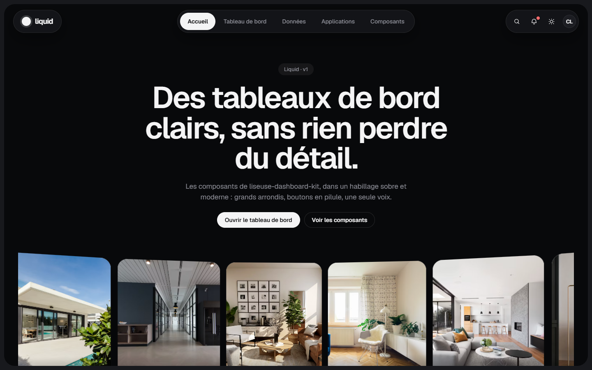
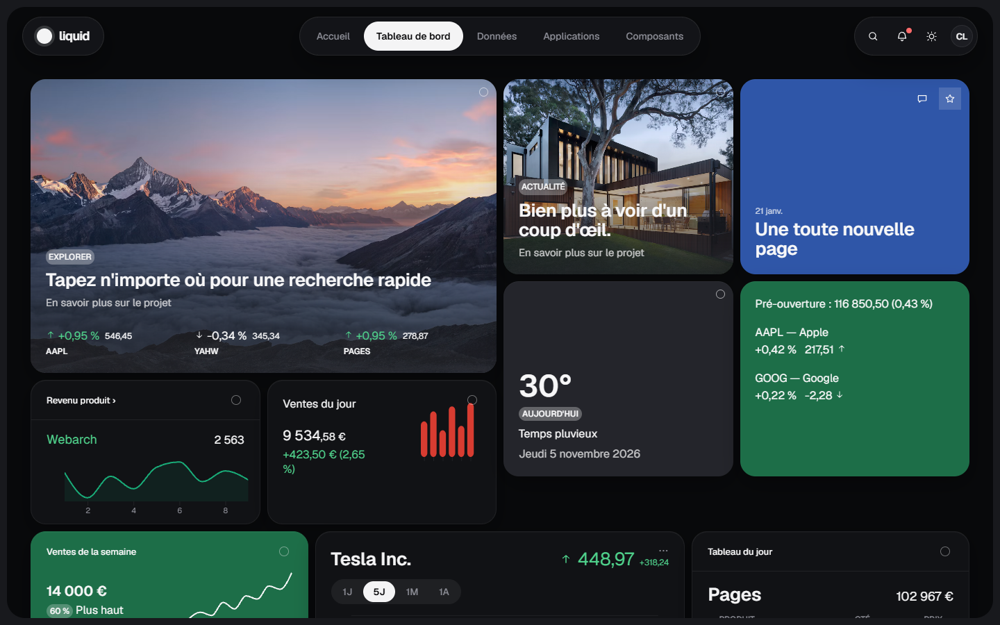
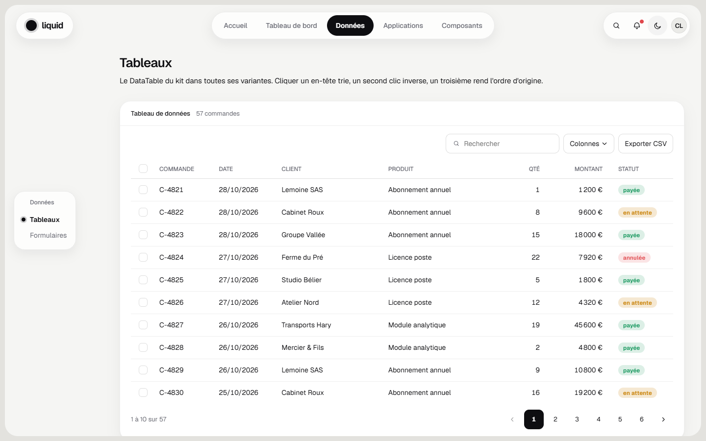
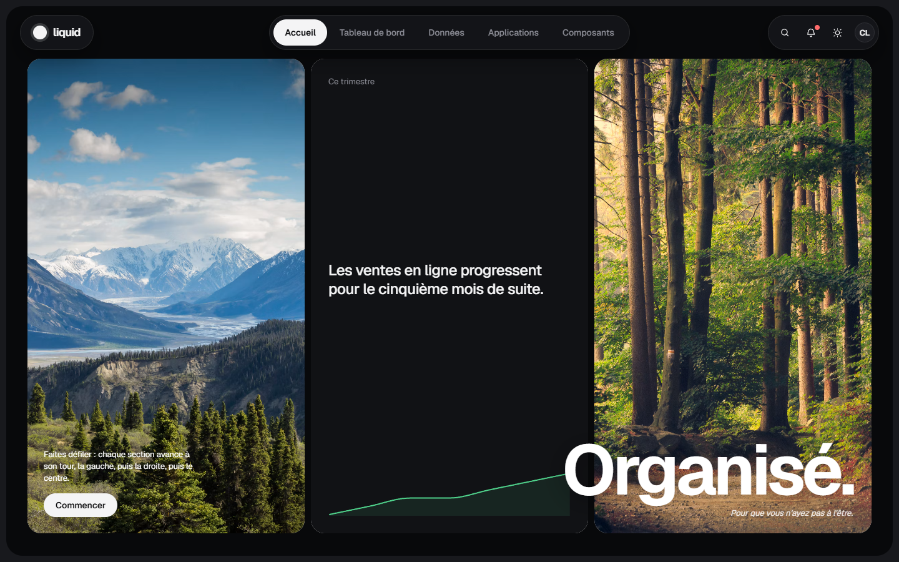
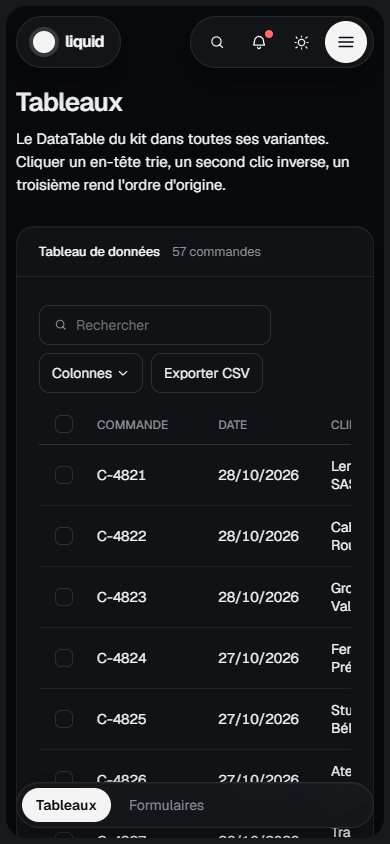

# liquid-glass-dashboard-kit

Les composants de [`@michaelthomasjach/liseuse-dashboard-kit`](https://github.com/michaelthomasjach/liseuse-dashboard-kit),
habillés du thème **Liquid** (v1) : sobre et moderne. Fond presque noir (blanc cassé en clair), surfaces
aux grands rayons, boutons et onglets en pilule, une seule police (Geist), un menu du haut en îlots
arrondis, un menu flottant à gauche et un cadre arrondi qui décolle le contenu des bords de la fenêtre.
Pensé pour rendre un tableau de bord dense agréable à lire, sans rien retirer de l'information.

C'est une **couche de thème**, comme [`minimal-dashboard-kit`](https://github.com/michaelthomasjach/minimal-dashboard-kit) :
aucun composant n'est réécrit ici. Le paquet ré-exporte tout le kit et ajoute `LiquidGlassTheme`. Une
modification du kit (correctif, nouveau composant, nouvelle prop) arrive donc ici sans rien toucher :
la dépendance suit toutes les versions 0.x du kit (`>=0.316.0 <1.0.0`).

**En ligne :** [Storybook](https://michaelthomasjach.github.io/liquid-glass-dashboard-kit/) ·
[vitrine](https://michaelthomasjach.github.io/liquid-glass-dashboard-kit/vitrine/)

## Aperçu



| | |
|---|---|
|  |  |
| **Tableau de bord** — tuiles, graphiques et tableaux du kit | **Tableaux** — menu flottant à gauche, l'écran ouvert marqué d'un point |
|  |  |
| **`TriptychScroll`** — trois sections qui se relaient au défilement | **Téléphone** — îlots en haut, pastilles du menu flottant en bas |

## Installation

Le paquet est publié sur GitHub Packages :

```ini
# .npmrc
@michaelthomasjach:registry=https://npm.pkg.github.com
//npm.pkg.github.com/:_authToken=${GITHUB_TOKEN}
```

```sh
npm install @michaelthomasjach/liquid-glass-dashboard-kit
```

```tsx
import { LiquidGlassTheme, HeaderLayout, FloatingNav, Card, Button } from "@michaelthomasjach/liquid-glass-dashboard-kit";
import "@michaelthomasjach/liquid-glass-dashboard-kit/style.css";

export function App() {
  return (
    <LiquidGlassTheme surface="dark">
      <HeaderLayout logo={<strong>Acme</strong>} navItems={[{ id: "a", label: "Vue d'ensemble", active: true }, { id: "b", label: "Marchés" }]}>
        <FloatingNav items={[{ id: "1", label: "Indices", active: true }, { id: "2", label: "Devises" }]} />
        <Card title="Portefeuille">
          <Button tone="primary">Échanger</Button>
        </Card>
      </HeaderLayout>
    </LiquidGlassTheme>
  );
}
```

`LiquidGlassTheme` accepte :

| Prop | Rôle |
|---|---|
| `surface` | `"dark"` (défaut, presque noir) ou `"light"` (blanc cassé) |
| `frame` | le cadre arrondi autour de la page (défaut `true`) ; `false` pour un thème posé sur une partie de page |
| `onSurfaceChange` | appelé quand un composant du kit bascule la surface |
| `className`, `style` | posés sur la racine (la classe suit dans les portails) |

La coquille prévue pour ce thème est `HeaderLayout` (menu du haut en îlots : marque, sections en
pilule, actions) avec `FloatingNav` (menu flottant de gauche, rangée de pastilles en bas sur
téléphone). `SidebarLayout` reste habillé pour les applications qui gardent un menu latéral.

## Comment ça marche

La v1 (2026-11-21) repart de zéro : l'ancien thème « verre » empilait plus de 1 500 lignes de règles
sur l'anatomie des composants. Celui-ci passe presque entièrement par les variables CSS `--lq-*` que
les ~200 composants du kit lisent déjà (y compris ses variables optionnelles), en trois feuilles :

| Feuille | Contenu |
|---|---|
| [`src/theme/tokens.css`](src/theme/tokens.css) | les variables : couleurs des deux surfaces, rayons, typographie, contrôles, tableaux, graphiques |
| [`src/theme/shell.css`](src/theme/shell.css) | le cadre arrondi, les îlots du menu du haut, le menu flottant, ce qui flotte (menus, recherche, modales) |
| [`src/theme/details.css`](src/theme/details.css) | ce que les variables ne disent pas : pilules des boutons et onglets, matière des champs |

Les variables sont redéfinies sous un sélecteur strictement plus spécifique que ceux du kit, donc
gagnant quel que soit l'ordre des imports :

```
.lgk.lq-root[data-lq-palette][data-lq-surface="dark"]   (0,4,0)  >  .lq-root[data-lq-palette="color"][data-lq-surface="dark"]   (0,3,0)
.lgk.lq-root                                            (0,2,0)  >  .lq-root                                                   (0,1,0)
```

Le cadre est un anneau fixé à la fenêtre (une ombre portée immense autour d'un rectangle arrondi
transparent) : le contenu défile dessous, les coins restent ronds, et le défilement reste celui de
la fenêtre.

## Développement

```sh
npm install            # GITHUB_TOKEN exporté dans le shell (le kit est sur GitHub Packages)
npm run dev            # la vitrine (src/showcase), sur Vite
npm run storybook      # les stories du kit, rendues dans ce thème (port 6008)
npm run build:lib      # le paquet, dans dist-lib/
npm version minor && npm publish
```

Le Storybook charge les stories du kit **depuis son dépôt voisin** (`../Dashboard liseuse`) : une
story ajoutée au kit apparaît ici au prochain lancement.
