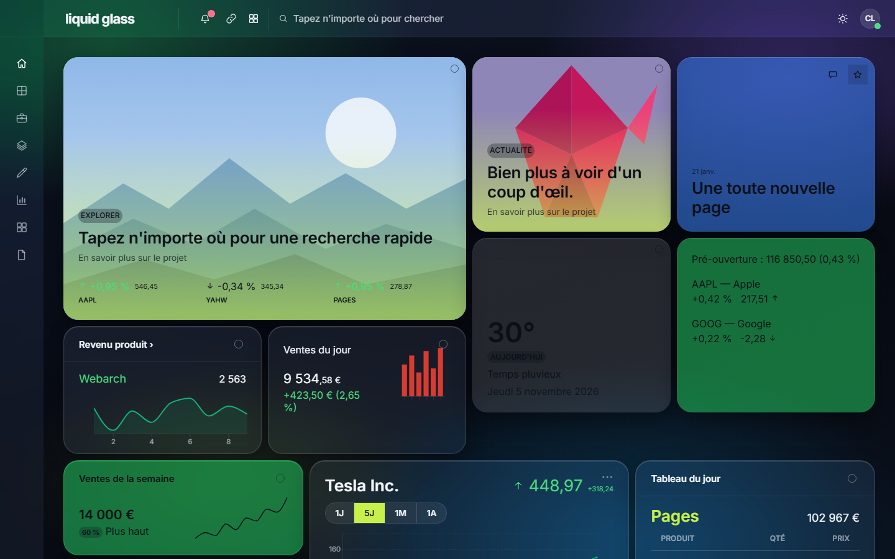
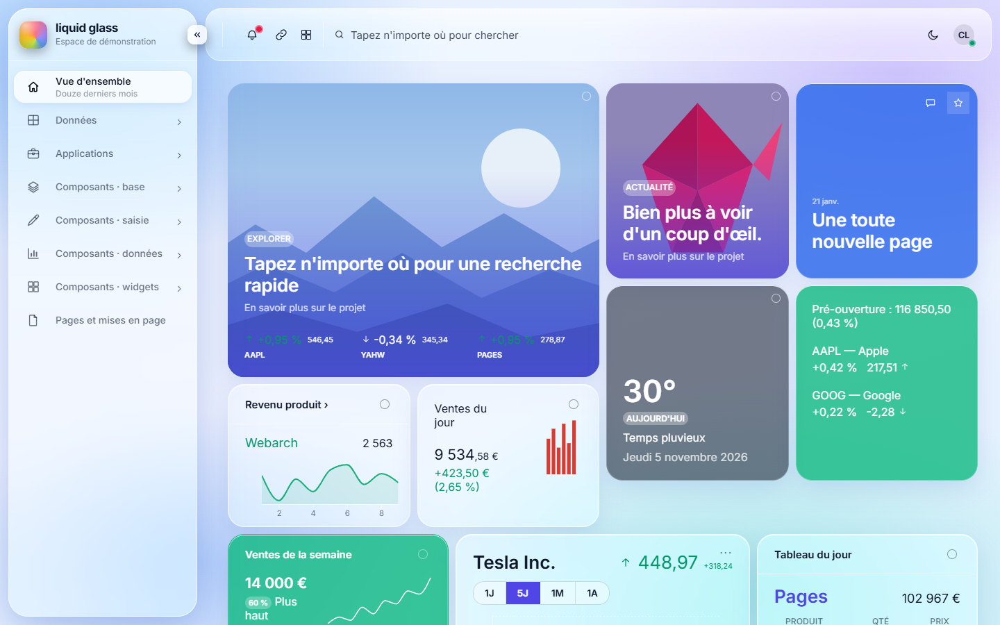
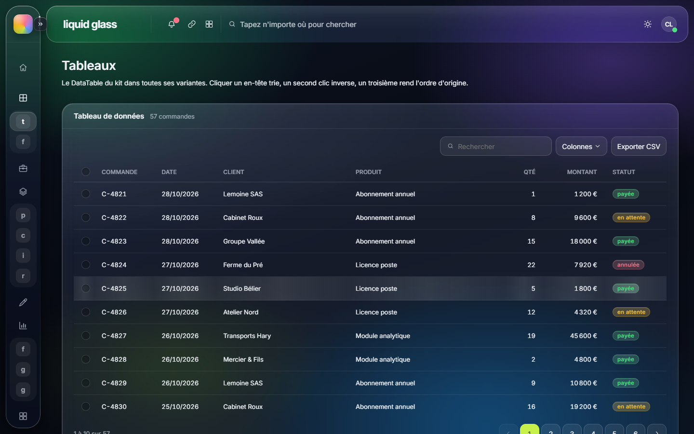
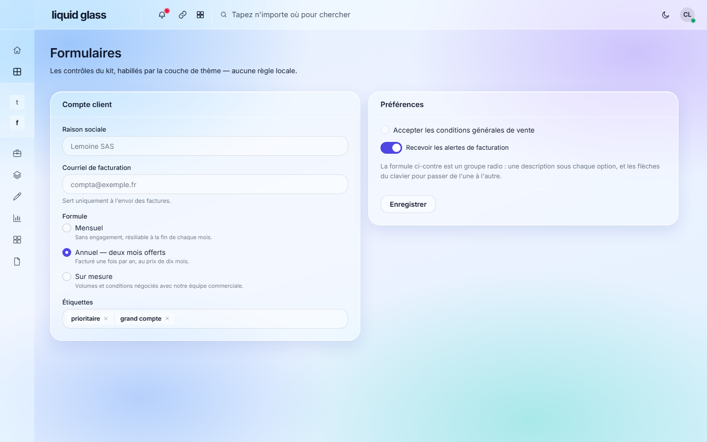

# liquid-glass-dashboard-kit

Les composants de [`@michaelthomasjach/liseuse-dashboard-kit`](https://github.com/michaelthomasjach/liseuse-dashboard-kit),
habillés d'un thème **Liquid glass** : surfaces de verre dépoli translucides, liseré de lumière,
grands rayons, sur un fond de halos colorés. Surfaces sombre et claire.

C'est une **couche de thème**, comme [`minimal-dashboard-kit`](https://github.com/michaelthomasjach/minimal-dashboard-kit) :
aucun composant n'est réécrit ici. Le paquet ré-exporte tout le kit et ajoute `LiquidGlassTheme`. Une
modification du kit (correctif, nouveau composant, nouvelle prop) arrive donc ici sans rien toucher :
la dépendance suit toutes les versions 0.x du kit (`>=0.314.0 <1.0.0`).

**En ligne :** [Storybook](https://michaelthomasjach.github.io/liquid-glass-dashboard-kit/) ·
[vitrine](https://michaelthomasjach.github.io/liquid-glass-dashboard-kit/vitrine/)

## Aperçu



| | |
|---|---|
|  |  |
| **Surface claire** — verre laiteux sur un ciel bleu et lilas | **Tableaux** — le `DataTable` du kit, sur verre fumé |
|  | |
| **Formulaires** — champs et contrôles du kit | |

## Installation

Le paquet est publié sur GitHub Packages :

```ini
# .npmrc
@michaelthomasjach:registry=https://npm.pkg.github.com
//npm.pkg.github.com/:_authToken=${GITHUB_TOKEN}
```

```sh
npm install @michaelthomasjach/liquid-glass-dashboard-kit
```

```tsx
import { LiquidGlassTheme, Card, Button } from "@michaelthomasjach/liquid-glass-dashboard-kit";
import "@michaelthomasjach/liquid-glass-dashboard-kit/style.css";

export function App() {
  return (
    <LiquidGlassTheme surface="dark" style={{ minHeight: "100vh" }}>
      <Card title="Portefeuille">
        <Button tone="primary">Échanger</Button>
      </Card>
    </LiquidGlassTheme>
  );
}
```

`LiquidGlassTheme` accepte :

| Prop | Rôle |
|---|---|
| `surface` | `"dark"` (défaut, verre fumé) ou `"light"` (verre laiteux) |
| `backdrop` | ce que le verre floute : une valeur `background-image` (`"url(/montagnes.jpg)"`, un dégradé) ; par défaut, les halos de la surface |
| `onSurfaceChange` | appelé quand un composant du kit bascule la surface |
| `className`, `style` | posés sur la racine (la classe suit dans les portails) |

Donnez à la racine la hauteur de la page (`minHeight: "100vh"`) : c'est elle qui porte le fond.

## Comment ça marche

Les ~200 composants du kit lisent leurs couleurs, rayons, espacements et ombres dans des variables
CSS `--lq-*` posées sur `.lq-root`. [`src/theme/liquid-glass.css`](src/theme/liquid-glass.css) les
redéfinit sous un sélecteur strictement plus spécifique que ceux du kit, donc gagnant quel que soit
l'ordre des imports :

```
.lgk.lq-root[data-lq-palette][data-lq-surface="dark"]   (0,4,0)  >  .lq-root[data-lq-palette="color"][data-lq-surface="dark"]   (0,3,0)
.lgk.lq-root                                            (0,2,0)  >  .lq-root                                                   (0,1,0)
```

Le verre lui-même vient de la variable `--lq-surface-backdrop` du kit (v0.314.0), lue en
`backdrop-filter` par `Panel`, `Card`, `Modal`, `Popover`, `ContextMenu` et la barre latérale de
`SidebarLayout`. Le thème y pose `blur(24px) saturate(165%)` avec une couleur de panneau
translucide, et un reflet d'un pixel en ombre intérieure. Ce qui flotte (menus, modales) prend un
verre plus dense pour rester lisible. Sans flou disponible, ou avec « réduire la transparence »,
les surfaces deviennent presque opaques.

Limite connue : une surface floutée devient le bloc conteneur de ses descendants en
`position: fixed` (les modales, menus et infobulles du kit passent par des portails et ne sont pas
concernés).

## Développement

```sh
npm install            # GITHUB_TOKEN exporté dans le shell (le kit est sur GitHub Packages)
npm run dev            # la vitrine (src/showcase), sur Vite
npm run storybook      # les stories du kit, rendues dans ce thème (port 6008)
npm run build:lib      # le paquet, dans dist-lib/
npm version minor && npm publish
```

Le Storybook charge les stories du kit **depuis son dépôt voisin** (`../Dashboard liseuse`) : une
story ajoutée au kit apparaît ici au prochain lancement.
